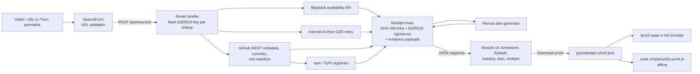

# Gravekeeper

**Good code deserves a second life.**

Websites go dark and open-source repositories get abandoned. Someone who wants to revive one, whether a developer picking up an old library or an archivist checking what survived, has to piece together what is still retrievable from the Internet Archive and GitHub, how far behind its dependencies are, and where to start. Gravekeeper puts that in one lookup. Enter a public URL and it finds the latest Internet Archive snapshot, charts how long the Archive saw the page, reads the repository's metadata, commits and root dependency manifest, and builds a revival checklist with named upgrade steps. Every upstream answer is recorded as an Ed25519-signed, SHA-256 hash-chained receipt, and the downloaded proof can be checked offline. That matters because it lets someone else check that a revival record has not been edited since it was made, without trusting the server. Built for Kiroween 2026, category **Resurrection**.

- Live app: https://gravekeeper-drab.vercel.app (Vercel Hobby, `GITHUB_TOKEN` and `FORK_API_SECRET` unset)
- Judge guide, mapping each criterion to evidence: [docs/JUDGES.md](docs/JUDGES.md)
- Demo script: [docs/DEMO_SCRIPT.md](docs/DEMO_SCRIPT.md) (no video recorded yet)

## Try it in 60 seconds

On the live app, no account or install needed:

1. Open https://gravekeeper-drab.vercel.app and click the `https://github.com/atom/atom` example under the search box, then **Resurrect**.
2. Read the results: the tombstone card (last push, archive snapshot, open issues), the **Epitaph** panel (first capture, last seen, captured months per year), the **Dependency autopsy** table and the revival plan.
3. In the proof section, click **Verify proof**, then **Download proof**.
4. Open https://gravekeeper-drab.vercel.app/proof and choose the downloaded `gravekeeper-proof.json`. It should say "Valid: internally consistent". Change one value in the file, such as the star count, and load it again to see it rejected.
5. Optional: open https://gravekeeper-drab.vercel.app/restoration and https://gravekeeper-drab.vercel.app/lantern-hill for the two bundled restorations.

The live lookup depends on GitHub's anonymous rate limit (60 requests/hour per server IP, shared by all visitors) and on the Internet Archive answering in time. If either fails, the app shows a partial result and says which source failed. For example, a production lookup of `atom/atom` on 2026-11-11 at 12:38 UTC returned "no archived snapshot" from the Wayback availability API while the CDX capture index for the same URL returned 136 captured months.

## What it does (merged on `main`)

| Feature | What you see | Honest limit |
|---|---|---|
| Lookup | Wayback availability snapshot for any public URL; for GitHub repos, metadata and the last 20 commits. Partial results when a source fails. | Public HTTP(S) URLs only; private repos, credentials, query strings, ports and IP hosts are rejected. |
| Epitaph timeline | Born, last seen, years on record and a captured-months-per-year chart with a table alternative, from the Internet Archive CDX index. | Month resolution, exact URL only, 10-second budget. Large hosts can time out (`www.geocities.com` did twice). See [docs/EPITAPH_TIMELINE.md](docs/EPITAPH_TIMELINE.md). |
| Dependency autopsy | Root `package.json`, `requirements.txt` or `pyproject.toml`, compared with npm or PyPI latest. Each package is labelled current, minor behind, major behind, unknown or not found. | Declared versions only. No lockfile, no transitive dependencies, no vulnerability data, 40 packages at most. See [docs/DEPENDENCY_AUTOPSY.md](docs/DEPENDENCY_AUTOPSY.md). |
| Revival plan | Ordered steps from metadata and the autopsy, such as "Upgrade react ^17.0.1 → 19.x (major behind)". | Not a code audit and not an automatic repair. |
| Signed receipts | One receipt per upstream answer (`wayback` or `wayback-miss`, `wayback-cdx`, `github-meta`, `github-commits`, `github-manifest`, `registry`, `spec`) with the evidence payload attached. | Shows internal consistency only, under a fresh key per lookup. It does not prove authorship or that GitHub, the Archive or a registry said it, and removing a valid suffix is not detectable. |
| Offline and in-browser verification | `node scripts/verify-proof.ts` and `/proof` use the same code. Both rebuild the displayed autopsy and timeline from the evidence. `/proof` accepts a file, a drop or a paste and uploads nothing. | Same limits as receipts. A real OS drag-and-drop and a screen reader were not tested on `/proof`. |
| Permalinks | `/?url=<encoded>` runs one lookup if the URL passes the same validation as the form. **Copy link** copies the permalink. | The link contains only the resource URL, not the result. |
| Restoration case 001 (`/restoration`) | The MIT `esrever` string reverser (pinned commit) passes 4 of 12 Unicode fixtures; an original `Intl.Segmenter` rewrite passes 12 of 12. Offline kit: `/restoration-kit.zip`. | One curated function. |
| Lantern Hill (`/lantern-hill`) | An original 1999-style page rewritten into semantic HTML5, with sandboxed before/after previews and signed before/after receipts. | Original fixture, not recovered history; the rewriter is not a sanitizer. |
| Share previews | Open Graph and Twitter images (1200×630), canonical URLs, `robots.txt`, `sitemap.xml`. | Rendering on real social networks was not checked. |
| Fork | **Fork on GitHub** opens GitHub's own fork page for the visitor to confirm. | The operator fork API is off on the demo. |

**Open, not merged:** PR #12 (revival kit: a `REVIVAL.md` and tracking-issue export from a verified lookup) is open and not on `main` or production.

## Architecture



Archive availability, the CDX index and GitHub metadata run in parallel; commits and the manifest are read only after metadata succeeds. Every client in `src/lib` returns `Result<T>` and uses a 10-second timeout. The verifiers in the browser and in `scripts/verify-proof.ts` share `src/lib/receipts/*` and `src/client/proof.ts`, so there is one hashing scheme.

## Run locally

Node.js 22.18+ (Node 24 tested) and npm. No API key or paid service is needed.

```sh
git clone https://github.com/mangeshraut712/gravekeeper.git && cd gravekeeper
npm ci
npm run dev              # http://localhost:3000
npm test                 # Vitest and fast-check
npm run demo:verify      # restoration: pinned source hash matches, 12/12 pass
```

More checks: `npm run lint`, `npx next typegen && npx tsc --noEmit`, `npm run build`, and, against a running production build, `BASE_URL=http://localhost:3000 npm run e2e` and `npm run a11y`. CI (`.github/workflows/ci.yml`) runs a `verify` job (tests, lint, typecheck, build) and a `browser` job (e2e and axe on Chromium) on every push and pull request.

## How Kiro built this

- [docs/KIRO_WORKFLOW.md](docs/KIRO_WORKFLOW.md): every file under `.kiro/` and whether it was observed working or is only configured.
- Specs (dependency autopsy and epitaph timeline were committed before any of their code; the proof workbench spec landed in the same commit as its code): [.kiro/specs/resurrect](.kiro/specs/resurrect), [.kiro/specs/dependency-autopsy](.kiro/specs/dependency-autopsy), [.kiro/specs/epitaph-timeline](.kiro/specs/epitaph-timeline), [.kiro/specs/proof-workbench](.kiro/specs/proof-workbench).
- Steering, agents, hooks and MCP config: [.kiro/steering](.kiro/steering), [.kiro/agents](.kiro/agents), [.kiro/hooks](.kiro/hooks), [.kiro/settings/mcp.json](.kiro/settings/mcp.json).
- [KIRO_USAGE.md](KIRO_USAGE.md): the dated session log, separating Kiro-generated work from hand work.
- [.kiro/evidence](.kiro/evidence): metadata-only records (session ids, provider-reported credits where exposed, checks run). No transcripts.
- Draft write-up: [docs/submission/WRITEUP.md](docs/submission/WRITEUP.md).

## Screenshots

Captured at 1440x900 from a local production build (`npm run build`, `next start`) with Playwright's Chromium by `scripts/capture-screenshots.mts`. Regenerate with `BASE_URL=http://localhost:3000 node scripts/capture-screenshots.mts`. These predate the Epitaph and autopsy panels; 375 px and 1440 px polish shots are in [docs/screenshots/polish](docs/screenshots/polish).


Home page landing view. The fog is a faint, slow background layer and is subtle in a still image.


Same page with `prefers-reduced-motion: reduce`; the fog overlay is hidden.


Results view. **This is not a live lookup.** `/api/resurrect` was mocked in the browser with a synthetic repository (`example/abandoned-widget`, invented data). The receipts are real, signed with the project's own receipt code, so the proof verifies, but they describe the synthetic data, not GitHub or the Internet Archive. The band in the background near the top is a full-page capture artifact.


Results view from a **live lookup** of `https://github.com/atom/atom` (not mocked), captured on 2026-11-11 from a local production build with `node scripts/capture-screenshots.mts --live`. The archive snapshot, repository metadata and commits come from the real Internet Archive and GitHub APIs at that moment, so a rerun will differ. The mocked screenshot above is kept and stays labeled as mocked.


`/restoration`, the licensed `esrever` restoration case.


`/lantern-hill`, the original 1999-style fixture before and after, with signed HTML receipts.

## Restoration demo (Resurrection case 001)

A small, end-to-end, licensed restoration lives at `/restoration` (linked from the home page).

- **Before:** the unmodified `esrever` string reverser by Mathias Bynens and contributors (MIT), pinned to commit `14b34013` under `third_party/esrever/upstream/`. It splits emoji sequences, flags, and skin tones.
- **After:** `src/lib/restoration/reverse.mts`, an original `Intl.Segmenter`-based `reverse()` written for this project.
- **Proof:** 12 explicit fixtures. Original: 4/12. Restored: 12/12.

```sh
npm run demo:verify    # exit 0: pinned source hash matches, restored version passes 12/12
npm run demo:baseline  # exit 1: the unchanged original fails the same contract
npm run demo:kit       # rebuild public/restoration-kit.zip (offline, Node 22.18+, no install)
```

Scope: one curated function, not an automatic repair of arbitrary repositories. Results follow the runtime's Unicode data. Reversing twice or preserving grapheme count is not guaranteed for arbitrary Unicode: leading combining marks and other boundary-sensitive sequences can regroup after reversal. The report is reproducible local execution, not a signed attestation.

## Original HTML fixture (Lantern Hill)

Open `/lantern-hill` for the reconciled PR #3 fixture: an original MIT-licensed 1999-style homepage, generated semantic HTML5, sandboxed side-by-side previews, and signed before/after HTML receipts. It makes no Wayback/GitHub request. Verify and download the receipts in the page, check them on `/proof`, or use `/api/verify` as described in [FIXTURES.md](FIXTURES.md).

This is a curated original fixture, not recovered third-party history. The rewriter is not an HTML sanitizer. Its receipt-export format is separate from live lookup proofs. The licensed `esrever` restoration above remains the primary abandoned-software demonstration.

## Check a proof in the browser

Open `/proof`, choose (or drop, or paste) a downloaded `gravekeeper-proof.json` or Lantern Hill receipt file. Verification runs in the tab using the same receipt code; nothing is uploaded. Valid means internally consistent, not authored by anyone in particular and not true of GitHub or the Archive. See [.kiro/specs/proof-workbench](.kiro/specs/proof-workbench).

## Verify a downloaded proof offline

Click **Download proof**, then run from this checkout:

```sh
node scripts/verify-proof.ts /path/to/gravekeeper-proof.json
```

No network request, dependency installation, or server is needed for verification. Exit 0 means internal consistency, exit 1 means invalid/unreadable proof, and exit 2 means missing arguments.

The verifier checks receipt sequence, predecessor hashes, signatures, evidence digests, and consistency with the included display data, including the autopsy and timeline. It does **not** establish authorship, authenticate GitHub, the Internet Archive or a registry, prove that claims are true, or detect removal of a valid suffix. Each lookup generates a fresh ephemeral signing key. To retain stronger provenance, preserve an independently trusted copy of the public key and final receipt hash at collection time.

## Build notes

The build uses the installed Next.js version's npm security-advisory check. A restricted execution environment may need to allow that read-only check and the native filesystem operations required by Turbopack. Do not disable security checks to conceal a build failure.

## Privacy and deployment safety

- Submit public HTTP(S) URLs only. Credentials, query strings, local addresses, and literal IP addresses are rejected. The submitted URL is sent to the Internet Archive and, for repository URLs, GitHub and the npm or PyPI registry.
- The application stores no user accounts or database records. Infrastructure logs may still record requests. Downloads stay in the visitor's browser unless the visitor shares them.
- Archive links open on `web.archive.org` over HTTPS. Treat old archived content as untrusted.
- **Recommended public deployment: leave `GITHUB_TOKEN` and `FORK_API_SECRET` unset.** Anonymous GitHub API limits apply.
- A narrowly scoped, public-read-only `GITHUB_TOKEN` may be supplied for higher lookup limits. Never expose it with a `NEXT_PUBLIC_` prefix. Private repository data is rejected.
- `/api/fork` is an optional **operator-only** route, disabled unless a separate `FORK_API_SECRET` of at least 32 characters is configured. It requires that secret in an `Authorization: Bearer ...` header in addition to a server-side GitHub token. The public interface does not call it. Do not configure write credentials on a public demo.
- Apply provider-level rate limits and spending controls before public deployment. Per-request upstream timeouts and cancellation are implemented; a distributed abuse limiter is not.
- No YouTube upload or contest submission is implied by this repository's presence.

## License and third-party services

MIT; see [LICENSE](LICENSE). The graveyard illustration is original inline SVG. System fonts avoid external font requests. GitHub, Internet Archive, npm and PyPI data, repositories, and snapshots remain subject to their respective rights and licenses. Review a repository's license before copying or reviving it.
