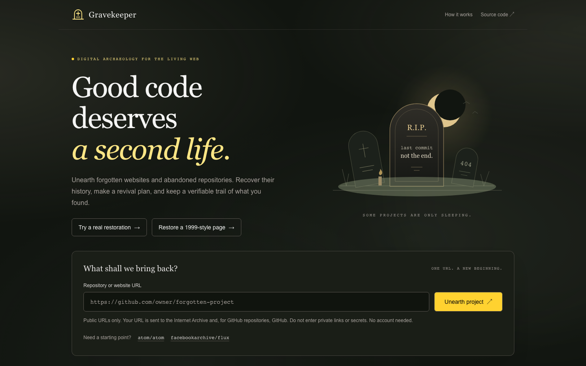
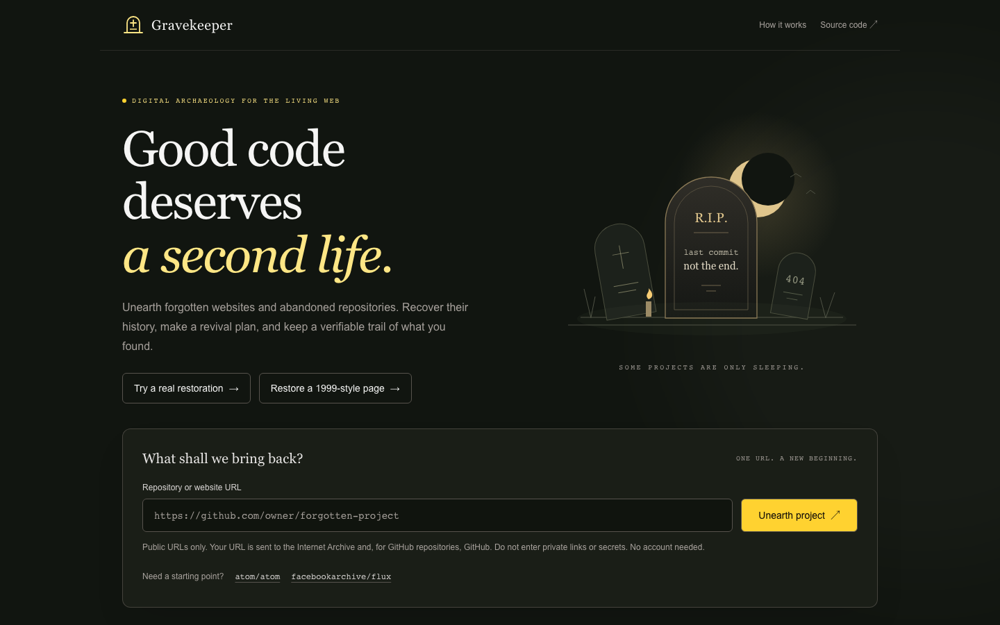
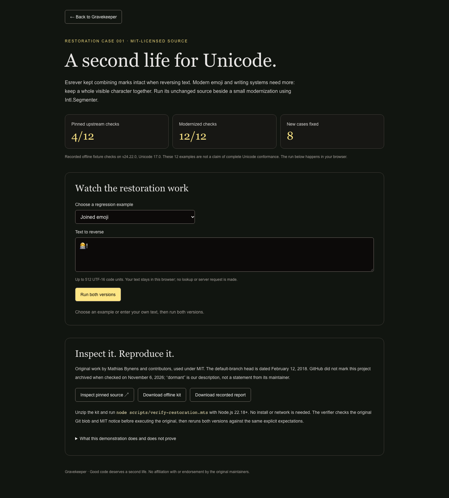
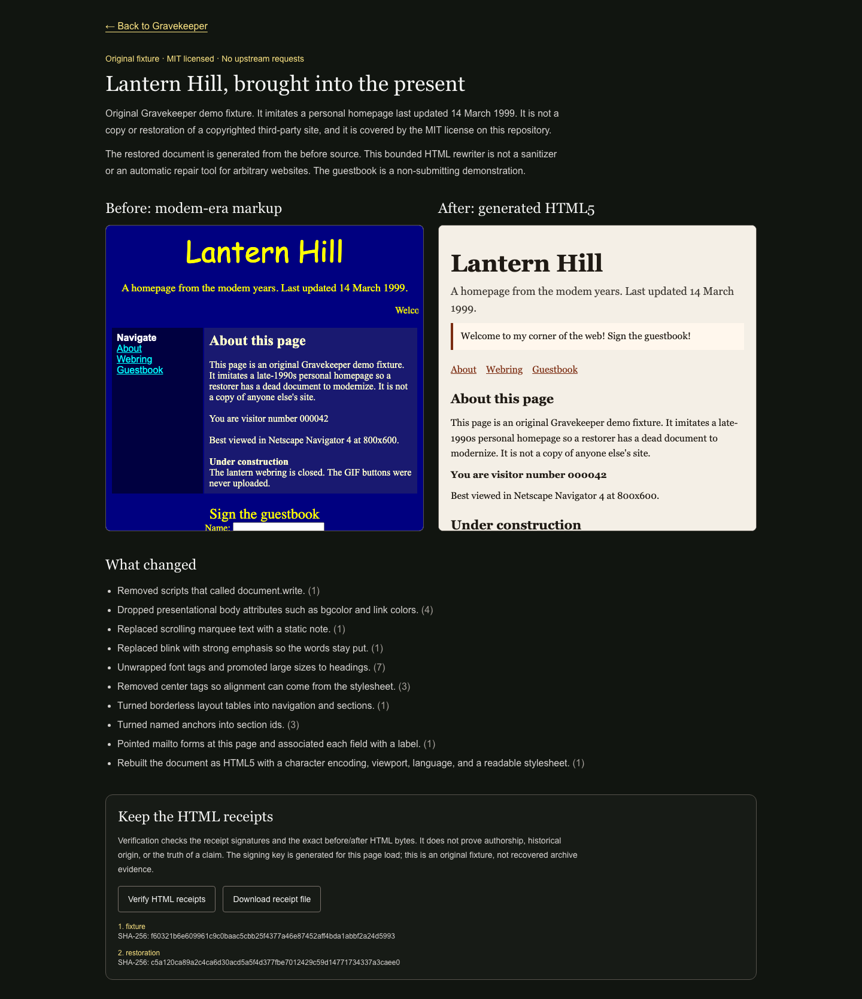

# Gravekeeper

**Good code deserves a second life.**

Gravekeeper is a digital-archaeology workbench for public websites and forgotten GitHub repositories, built for Kiroween 2026. Enter a URL to find an Internet Archive snapshot, inspect repository history, generate a practical revival checklist, and export a self-contained, tamper-evident record of the lookup.

## Live demo

A public Hobby deployment is at https://gravekeeper-drab.vercel.app (`GITHUB_TOKEN` and `FORK_API_SECRET` unset). This is a preview host for development and judging, not a contest submission.

- Home / lookup: https://gravekeeper-drab.vercel.app
- Restoration case: https://gravekeeper-drab.vercel.app/restoration
- Lantern Hill fixture: https://gravekeeper-drab.vercel.app/lantern-hill
- Proof checker (in-browser, no upload; available once this branch is deployed): `/proof`

A ~90 second demo walkthrough is in [docs/DEMO_SCRIPT.md](docs/DEMO_SCRIPT.md). Accessibility scan results and the keyboard path are in [docs/A11Y_AUDIT.md](docs/A11Y_AUDIT.md) (`npm run a11y`). CI (`.github/workflows/ci.yml`) runs tests, lint, typecheck, and build on every push and pull request.

## Screenshots

Captured at 1440x900 from a local production build (`npm run build`, `next start`) with Playwright's Chromium by `scripts/capture-screenshots.mts`. Regenerate with `BASE_URL=http://localhost:3000 node scripts/capture-screenshots.mts`.



Home page landing view. The fog is a faint, slow background layer and is subtle in a still image.



Same page with `prefers-reduced-motion: reduce`; the fog overlay is hidden.


Results view. **This is not a live lookup.** `/api/resurrect` was mocked in the browser with a synthetic repository (`example/abandoned-widget`, invented data). The receipts are real, signed with the project's own receipt code, so the proof verifies, but they describe the synthetic data, not GitHub or the Internet Archive. The band in the background near the top is a full-page capture artifact.


Results view from a **live lookup** of `https://github.com/atom/atom` (not mocked), captured on 2026-11-11 from a local production build with `node scripts/capture-screenshots.mts --live`. The archive snapshot, repository metadata and commits come from the real Internet Archive and GitHub APIs at that moment, so a rerun will differ. The mocked screenshot above is kept and stays labeled as mocked.



`/restoration`, the licensed `esrever` restoration case.



`/lantern-hill`, the original 1999-style fixture before and after, with signed HTML receipts.

## What works

- Live Internet Archive and public GitHub lookups, with partial results when a source is unavailable.
- A responsive, keyboard-accessible graveyard interface, cancelable searches, reduced-motion support, and actionable error states.
- Repository facts and a metadata-based revival plan. **This is not an automated source-code repair or dependency audit.**
- Ed25519 signatures, SHA-256 receipt links, and included evidence payloads. Browser and offline verification use the same implementation.
- A GitHub fork link that lets the visitor review and confirm using their own account. The app never forks through the visitor's browser using a shared operator token.

## Restoration demo (Resurrection case 001)

A small, end-to-end, licensed restoration lives at http://localhost:3000/restoration (linked from the home page).

- **Before:** the unmodified `esrever` string reverser by Mathias Bynens and contributors (MIT), pinned to commit `14b34013` under `third_party/esrever/upstream/`. It splits emoji sequences, flags, and skin tones.
- **After:** `src/lib/restoration/reverse.mts`, an original `Intl.Segmenter`-based `reverse()` written for this project.
- **Proof:** 12 explicit fixtures. Original: 4/12. Restored: 12/12.

```sh
npm run demo:verify    # exit 0: pinned source hash matches, restored version passes 12/12
npm run demo:baseline  # exit 1: the unchanged original fails the same contract
npm run demo:kit       # rebuild public/restoration-kit.zip (offline, Node 22.18+, no install)
```

Scope: one curated function, not an automatic repair of arbitrary repositories. Results follow the runtime's Unicode data. Reversing twice or preserving grapheme count is not guaranteed for arbitrary Unicode: leading combining marks and other boundary-sensitive sequences can regroup after reversal. The report is reproducible local execution, not a signed attestation.

## Original HTML fixture (Lantern Hill)

Open http://localhost:3000/lantern-hill for the reconciled PR #3 fixture: an original MIT-licensed 1999-style homepage, generated semantic HTML5, sandboxed side-by-side previews, and signed before/after HTML receipts. It makes no Wayback/GitHub request. Verify and download the receipts in the page, or use `/api/verify` as described in [FIXTURES.md](FIXTURES.md).

This is a curated original fixture, not recovered third-party history. The rewriter is not an HTML sanitizer. Its receipt-export format is separate from live lookup proofs. The licensed `esrever` restoration above remains the primary abandoned-software demonstration.

## Run locally

Use Node.js 22.18+ (Node 24 tested) and npm.

```sh
npm ci
npm run dev
```

Open http://localhost:3000. No API key or paid service is required. Try `https://github.com/atom/atom` or `https://github.com/facebookarchive/flux`.

```sh
npm test
npm run lint
npx tsc --noEmit
npm run build
npm start
```

The build uses the installed Next.js version's npm security-advisory check. A restricted execution environment may need to allow that read-only check and the native filesystem operations required by Turbopack. Do not disable security checks to conceal a build failure.

## Check a proof in the browser

Open `/proof`, choose (or drop, or paste) a downloaded `gravekeeper-proof.json` or Lantern Hill receipt file. Verification runs in the tab using the same receipt code; nothing is uploaded. Valid means internally consistent, not authored by anyone in particular and not true of GitHub or the Archive. See [.kiro/specs/proof-workbench](.kiro/specs/proof-workbench).

## Verify a downloaded proof offline

Click **Download proof**, then run from this checkout:

```sh
node scripts/verify-proof.ts /path/to/gravekeeper-proof.json
```

No network request, dependency installation, or server is needed for verification. Exit 0 means internal consistency, exit 1 means invalid/unreadable proof, and exit 2 means missing arguments.

The verifier checks receipt sequence, predecessor hashes, signatures, evidence digests, and consistency with the included display data. It does **not** establish authorship, authenticate GitHub or the Internet Archive, prove that claims are true, or detect removal of a valid suffix. Each lookup generates a fresh ephemeral signing key. To retain stronger provenance, preserve an independently trusted copy of the public key and final receipt hash at collection time.

## Privacy and deployment safety

- Submit public HTTP(S) URLs only. Credentials, query strings, local addresses, and literal IP addresses are rejected. The submitted URL is sent to the Internet Archive and, for repository URLs, GitHub.
- The application stores no user accounts or database records. Infrastructure logs may still record requests. Downloads stay in the visitor's browser unless the visitor shares them.
- Archive links open on `web.archive.org` over HTTPS. Treat old archived content as untrusted.
- **Recommended public deployment: leave `GITHUB_TOKEN` and `FORK_API_SECRET` unset.** Anonymous GitHub API limits apply.
- A narrowly scoped, public-read-only `GITHUB_TOKEN` may be supplied for higher lookup limits. Never expose it with a `NEXT_PUBLIC_` prefix. Private repository data is rejected.
- `/api/fork` is an optional **operator-only** route, disabled unless a separate `FORK_API_SECRET` of at least 32 characters is configured. It requires that secret in an `Authorization: Bearer ...` header in addition to a server-side GitHub token. The public interface does not call it. Do not configure write credentials on a public demo.
- Apply provider-level rate limits and spending controls before public deployment. Per-request upstream timeouts and cancellation are implemented; a distributed abuse limiter is not.
- A public Vercel demo is documented above. No YouTube upload or contest submission is implied by this repository's presence.

## How Kiro was used

See [KIRO_USAGE.md](KIRO_USAGE.md), the draft judge write-up in [docs/submission/WRITEUP.md](docs/submission/WRITEUP.md), the committed [.kiro](.kiro) steering/spec/task files, and review metering evidence in [.kiro/evidence](.kiro/evidence). The log distinguishes Kiro-generated work, manual implementation, unsuccessful quota-limited sessions, and Kiro's later read-only review. It does not claim that untested hook or MCP configurations were exercised.

## License and third-party services

MIT; see [LICENSE](LICENSE). The graveyard illustration is original inline SVG. System fonts avoid external font requests. GitHub and Internet Archive data, repositories, and snapshots remain subject to their respective rights and licenses. Review a repository's license before copying or reviving it.
